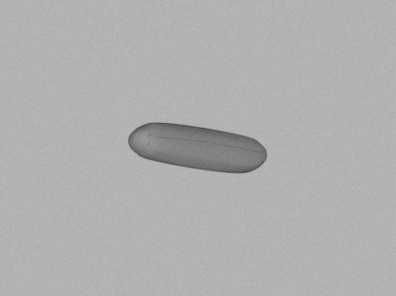
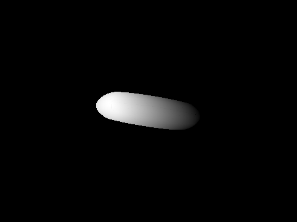

# Synthetic plankton image generation

A Blender 5.2 pipeline for generating paired grayscale images and depth maps from 3D plankton models. The repository is inspired by [Forams-3DGeneration](https://github.com/ARoS-NCSU/Forams-3DGeneration) and it adapts Fibonacci orientation sampling from it.

## Generation pipeline

For each 3D model, the pipeline:

1. Centers the model and uniformly scales its largest dimension to a configured size.
2. Applies a grey diffuse material, camera-facing white SUN illumination and a grey background visible only to the camera.
3. Rotates the model using seeded Fibonacci-sphere sampling while keeping the camera fixed.
4. Renders grayscale intensity and depth together to keep each pair aligned.
5. Optionally denoises the Cycles render, then adds Gaussian intensity noise to the grayscale image. Depth and masks receive no noise.
6. Saves the images, foreground masks, rotations and generation settings. Optionally saves a Blender scene for inspection.

A fresh scene is built for each batch. Source models are not modified or deformed.

## Setup and usage
- Blender 5.2
Python dependencies are in `requirements.txt`.

Place your 3D models to `data/synthetic`, edit [scripts/render_config.yaml](scripts/render_config.yaml), and run:
```
python scripts/offline_generation.py --blender <path/to/blender>
```
The launcher reads YAML and starts Blender; Blender supplies the rendering API and NumPy. Adjust the executable path for your installation.

| Optional flag | Purpose |
|---|---|
| `--config PATH` | Use another YAML configuration. |
| `--model-filter "Halamphora sp*"` | Render matching model filenames only. |
| `--save-scene` | Save `inspection.blend` with each model in its first sampled pose. |

## Configuration

All image-generation settings are in [scripts/render_config.yaml](scripts/render_config.yaml):

| Section | Controls |
|---|---|
| `input_dir`, `output_dir` | Input and output locations, relative to the repository root; absolute paths also work. |
| `render` | Views per model, samples per pixel, resolution, denoising, lighting, background, noise, depth convention, device and seed. |
| `camera` | Camera distance, focal length and sensor width. |
| `particle` | Maximum normalized model dimension and diffuse grey reflectance. |

## Outputs
Results are written under `<output_dir>`:

| File | Contents |
|---|---|
| `0000_rgb.png` | 8-bit single-channel grayscale image; the filename is retained for compatibility. |
| `0000_depth.png` | Per-image normalized 16-bit depth. By default: background **0**, farthest surface **1**, closest surface **65535**. |
| `0000_depth.exr` | Raw 32-bit floating-point camera distances in Blender scene units. |
| `0000_mask.png` | Foreground **255**, background **0**. |
| `metadata.json` | Source path, settings, centering/scale, per-view rotations and depth bounds. |
| `rotations.csv` | Quaternions in Blender's `(w,x,y,z)` order. |

> [!NOTE]
> Auto-scaling removes real-world size information: EXR distances describe the synthetic scene, not plankton dimensions. PNG depth values are normalized separately for each view. Use the saved depth bounds to recover approximate scene distances. 

## Inspecting scene in Blender

Use `--save-scene` setting to save the build blender scene, which can be opened in Blender for manual inspecition., open the resulting `inspection.blend`, and press **Numpad 0** for camera view and **F12** to render. Manual renders write to `manual_preview` and do not run the Python noise or depth-PNG processing steps. Editing this scene does not change later batch renders.

See the [Blender lighting guide](scripts/lighting_in_blender.md) for area lights, symmetric fill and ambient illumination. Further implementation details are in [scripts/README.md](scripts/README.md).


## Data
There are some publicly available 3D plankton models, for which two are contained in the `data/synthetic` folder. These 2 models in the `data/synthetic` are from [Sun et al. 2024](doi.org/10.3389/fmicb.2024.1429179). More models can be found following sources:
- 9 Models are from [U.S. National Office for Harmful Algal Blooms (WHOI)](https://hab.whoi.edu/regions-resources/interactive-graphics-3d-models/)
- 10 models are from [Pandorina](https://pandorina.org/free-3d-models/)

## Example outputs

RGB Image                  |  Depth image
:-------------------------:|:-------------------------:
  |  